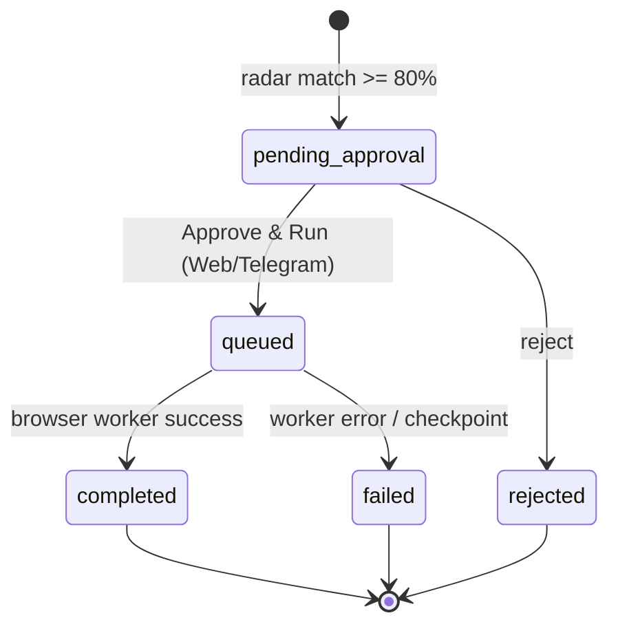

# MASTER PROMPT — Affiliate Automation ERP (In-house System)

> Status: brainstorm / pre-implementation. Source of truth for scope, schema, UI rules, and workflows.
> Nothing here is built yet. This document is the input spec for agents implementing the system.

---

## 1. Project Overview & Objective

| Field | Value |
|---|---|
| Project name | In-house Affiliate Automation & Social Hub |
| Target users | Solo operator (single user), Desktop for dashboard management + Mobile/Tablet for quick approval and Telegram/Web hybrid workflow |
| Core mission | Automate product discovery from Shopee/Lazada, monitor Facebook Groups/KOLs via AI, manage a farm of social accounts with auto-persona warming, and execute contextual human-like comment/seeding tasks to drive affiliate revenue safely |
| Key requirement | **Mobile-first & fully responsive UI** (Tailwind breakpoints `sm`, `md`, `lg`, `xl`) so notifications can be checked and AI comment drafts approved directly from phones or iPads |

---

## 2. Technology Stack & Environment

| Layer | Choice |
|---|---|
| Frontend / Dashboard | Next.js 14+ (App Router), TypeScript, Tailwind CSS, Shadcn UI, Lucide React (icons) |
| Backend / Database | Supabase (PostgreSQL, Row Level Security, Realtime Subscriptions, pgvector for semantic product matching) |
| Automation workers | Python (FastAPI + Playwright) **or** Node.js (BullMQ), interfacing with Antidetect Browser APIs (GPM-Login / Genlogin) for browser automation |
| AI integration | Google Gemini API (`gemini-1.5-flash`) for multimodal post analysis, image understanding, copywriting |
| Deployment | Vercel (frontend), self-hosted VPS (Docker for workers & Supabase local/cloud) |

---

## 3. Database Schema Design (Supabase / PostgreSQL)

```sql
-- 1. SOCIAL ACCOUNTS (Phân hệ 1 & 2)
create table social_accounts (
  id uuid primary key default gen_random_uuid(),
  name text not null,
  platform text default 'facebook',
  persona_type text not null, -- 'decor', 'me_bim', 'tech', etc.
  browser_profile_id text, -- ID from GPM/Genlogin
  proxy_ip text,
  status text default 'active', -- 'active', 'cooldown', 'checkpoint'
  trust_score int default 10, -- 0 to 100
  bio_link_url text,
  last_action_at timestamp with time zone,
  created_at timestamp with time zone default now()
);

-- 2. TARGET SOURCES (Phân hệ 3)
create table target_sources (
  id uuid primary key default gen_random_uuid(),
  name text not null,
  url text not null,
  source_type text not null, -- 'group', 'fanpage', 'kol', 'forum'
  niche text,
  tone_of_voice text,
  group_rules text,
  scan_interval_mins int default 15,
  is_active boolean default true,
  last_scanned_at timestamp with time zone
);

-- 3. PRODUCTS & AFFILIATE POOL (Phân hệ 4)
create table products (
  id uuid primary key default gen_random_uuid(),
  shopee_item_id text unique,
  name text not null,
  price numeric,
  commission_rate numeric, -- e.g., 15.5 for 15.5%
  affiliate_short_link text not null,
  review_images jsonb, -- Array of real user review image URLs
  pros_cons_summary text,
  niche text,
  embedding vector(1536), -- For AI semantic matching
  created_at timestamp with time zone default now()
);

-- 4. COMMENT TASKS & APPROVAL QUEUE (Phân hệ 5 & 6)
create table comment_tasks (
  id uuid primary key default gen_random_uuid(),
  source_id uuid references target_sources(id),
  post_url text not null,
  post_content text,
  post_images jsonb,
  matched_product_id uuid references products(id),
  assigned_account_id uuid references social_accounts(id),
  ai_draft_comment text,
  selected_review_image text,
  execution_mode text default 'single', -- 'single', 'seeding_2_accounts'
  status text default 'pending_approval', -- 'pending_approval', 'queued', 'completed', 'failed', 'rejected'
  sub_id_code text,
  created_at timestamp with time zone default now()
);

-- 5. ANALYTICS & ROI (Phân hệ 7)
create table affiliate_conversions (
  id uuid primary key default gen_random_uuid(),
  task_id uuid references comment_tasks(id),
  sub_id text,
  order_amount numeric,
  estimated_commission numeric,
  status text default 'pending', -- 'pending', 'settled', 'canceled'
  converted_at timestamp with time zone default now()
);
```

### 3.1 Derived state machines

Documented from the enum comments above — these are the contracts workers and UI must honor.

- **`social_accounts.status`**: `active` → `cooldown` → `active`; `checkpoint` is a terminal/manual-intervention state requiring human action before the account can return to `active`.
- **`comment_tasks.status`**: `pending_approval` → (`queued` | `rejected`) → (`completed` | `failed`).
- **`affiliate_conversions.status`**: `pending` → (`settled` | `canceled`).
- **`social_accounts.trust_score`**: integer `0..100`, default `10`; incremented by the persona-warming workflow (§5.2).
- **`comment_tasks.execution_mode`**: `single` (one account comments) | `seeding_2_accounts` (two-tier comment/reply logic).

---

## 4. Frontend Architecture & Mobile Responsive UI Guidelines

### 4.1 Layout structure

**Desktop (`lg` and up)**
- Sidebar navigation on the left, main content area on the right.
- Split-view for the Approval Queue: **left = post feed list, right = AI draft + product card**, so approve/reject never needs a page change.

**Mobile & Tablet (below `lg`)**
- Collapsible hamburger menu.
- Bottom navigation bar for core quick actions: **Queue, Products, Accounts, Analytics**.
- Stacked single-column views; full-width touch-friendly buttons with `min-h-[44px]`.

### 4.2 Design system & components (Tailwind + Shadcn)

- Cards with clean padding for posts and products: `p-4 sm:p-6`.
- Swipeable tabs or segmented controls for switching between mobile views.
- Realtime toast notifications via `sonner` when the radar captures a new high-intent post.

---

## 5. Core Business Logic & Automation Workflows

### 5.1 Radar & AI Matching

1. Worker scrapes posts from `target_sources` (respecting `scan_interval_mins`, `is_active`).
2. Sends post text **and** images to `gemini-1.5-flash` together with the product catalog context.
3. Scores matching probability; only matches **≥ 80%** proceed.
4. Inserts into `comment_tasks` with `status = 'pending_approval'`.
5. Triggers realtime update on the web dashboard **and** the Telegram bot.

### 5.2 Auto-Persona & Profile Builder

1. Background worker runs cron jobs to publish lifestyle posts on `social_accounts` per that account's persona schedule.
2. Triggers cross-warming internal comments among accounts.
3. Automatically increments `trust_score`.

### 5.3 Execution & Human-Like Queue

1. User clicks **[Approve & Run]** on Web or Telegram.
2. Task status flips to `queued`.
3. Worker calls the Antidetect Browser API (GPM/Genlogin) with the account's `browser_profile_id` / `proxy_ip`.
4. Simulates human scrolling, random typing delays, image attachment from Shopee feedback storage, and optional 2-tier comment/reply logic.

### 5.4 Task lifecycle



---

## 6. Open Questions / Undecided

Gaps in the original brainstorm. Status as of the build (README → *Schema notes*
has the reasoning):

| # | Gap | Status |
|---|---|---|
| 1 | `products.embedding vector(1536)` conflicts with a Gemini-only stack | **Resolved** — `vector(768)` for `gemini-embedding-001` (`outputDimensionality: 768`; `text-embedding-004` is retired for new keys); the radar embeds a post, retrieves candidates with `match_products()` (pgvector), then Gemini re-ranks. |
| 2 | Telegram bot referenced by §5.1/§5.3 but absent from the stack | **Resolved** — `/api/telegram/webhook` (secret-token auth, constant-time compare) with `/queue`, `/status`, inline `approve:`/`reject:` callbacks, plus capture and silent-worker alerts. Verified end to end against a real bot. |
| 3 | Worker runtime: FastAPI+Playwright vs Node+BullMQ | **Resolved** — Node + Playwright in `workers/`; the bearer-token API in `src/app/api/worker/*` stays runtime-agnostic. BullMQ was not needed: the claim RPC (`FOR UPDATE SKIP LOCKED`) is the queue. |
| 4 | Antidetect provider: GPM-Login vs Genlogin | **Resolved** — `ANTIDETECT_PROVIDER=local` is the default: the operator's own Chrome with one persistent profile per account (verified: real login, TOTP, session persistence, profile lock). Both vendor adapters remain for when several personas must run from one machine, which is the only thing an antidetect tool adds. |
| 5 | `seeding_2_accounts` needs two accounts, schema had one | **Resolved** — `secondary_account_id` + a check constraint for seeding mode. |
| 6 | No uniqueness on `post_url`, radar re-drafts the same post | **Resolved** — `unique (post_url)`, with URL normalisation in `/api/worker/radar/ingest`. |
| 7 | Sub_ID ↔ conversion attribution undefined | **Resolved** — `comment_tasks.sub_id_code` unique, `affiliate_conversions.external_order_id` unique for idempotent postbacks, and both views attribute on `task_id` **or** `sub_id`. |
| 8 | RLS claimed but no auth model | **Resolved** — operator allowlist (`public.operators` + `is_operator()`); non-operators sign in and are refused; workers use the service role. |
| 9 | Trust score / cooldown / checkpoint rules unspecified | **Resolved** — `cooldown_until` gates claiming, `checkpoint` is operator-only to clear, trust `+1` per successful publish (clamped 0..100). |
| 10 | `group_rules` / `tone_of_voice` stored but never fed to the prompt | **Resolved** — both are injected by `lib/ai/prompts.ts` and auditable on `/ai`. |

Additional gaps found while building (not in the original brainstorm):

| # | Gap | Status |
|---|---|---|
| 11 | Nothing limited actions per account per day — a queue of fifty tasks would post fifty comments in an afternoon | **Resolved** — `daily_comment_limit` (8), `daily_warming_limit` (4) and `min_action_gap_minutes` (20) per account, enforced in `claim_comment_tasks()` and in the warming scheduler; `v_account_daily_usage` feeds the dashboard. |
| 12 | Accounts imported from the operator's export had no warming schedule, so they never posted anything | **Resolved** — imports and new accounts start from `DEFAULT_PERSONA_SCHEDULE`; `warmup_enabled` is the off switch. |
| 13 | A profile could warm for weeks with an empty avatar and no bio — the clearest tell of a farm | **Resolved** — `profile_setup` runs first (avatar/cover/bio from `workers/assets`), is verified as a visitor would see it, and drives a completion score on the account page. |
| 14 | Orders that arrived before their task had a Sub_ID stayed unattributed forever | **Resolved** — `/api/cron/reconcile` fills `task_id` where the Sub_ID now exists. |
| 15 | Orders can only be created by hand or CSV | **Resolved (CSV)** — `/products` → Nhập CSV parses the affiliate export (aliases, delimiters, money/percent semantics). Direct API discovery remains open (see the completion list in README). |

---

## 7. Module Map

Original module numbering (Phân hệ), retained for traceability:

| Phân hệ | Module | Tables / surface |
|---|---|---|
| 1 & 2 | Account farm + persona warming | `social_accounts` |
| 3 | Target source management | `target_sources` |
| 4 | Product & affiliate pool | `products` |
| 5 & 6 | Radar/AI drafting + approval queue | `comment_tasks` |
| 7 | Analytics & ROI | `affiliate_conversions` |
